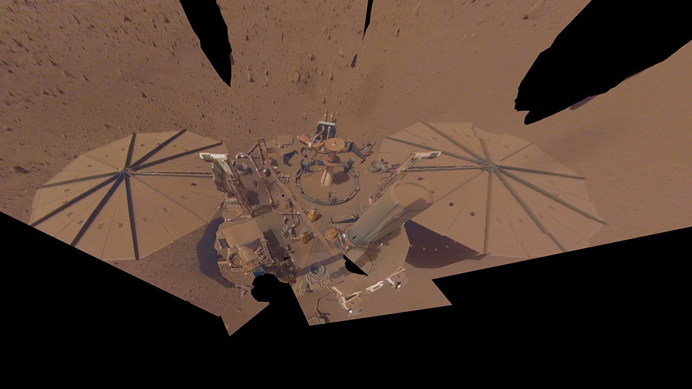

<div align="center">

<p><strong>TEAM AVANTGARDE · BISHKEK, KYRGYZSTAN</strong></p>

# Abandoned but not Forgotten

### Ghost Hardware of the Moon & Mars

**They stopped working. They are still out there.**

A browser-based journey through the machines we left behind — and the science they made possible.

[](https://codemicronx.github.io/nasa-Avantgarde/)
[](https://www.spaceappschallenge.org/2026/challenges/)
[](https://threejs.org/)

**47 object stories · 3 playable campaigns · Moon & Mars maps · Interactive 3D · Pip, your robot guide**

[Play the Simulator](https://codemicronx.github.io/nasa-Avantgarde/#game) · [Explore the Moon](https://codemicronx.github.io/nasa-Avantgarde/#moon) · [Browse the Museum](https://codemicronx.github.io/nasa-Avantgarde/#catalog) · [View Sources](https://codemicronx.github.io/nasa-Avantgarde/#sources)



<sub>InSight on Mars. Mission imagery: NASA/JPL-Caltech. A machine can fall silent while its discoveries keep speaking.</sub>

</div>

---

## The mission

What happens to a spacecraft after its final transmission?

**Abandoned but not Forgotten** turns that question into an interactive learning experience. Step into mission control, make decisions inspired by real missions, inspect spacecraft in 3D, and discover where the hardware ended up.

Built by **Team Avantgarde** for **NASA International Space Apps Challenge 2026**, Bishkek Local Event, the project responds to *“Abandoned but not Forgotten: Storytelling about NASA’s Discarded Equipment on the Moon and Mars.”*

Our focus is school-age explorers, especially ages **11–15**, along with teachers and curious adults. We connect each machine with four questions: **What was it built to do? What did it discover? Why did it stop? What remains?**

> **The idea:** make space history something you can explore, question, and play through — with sources close enough to check for yourself.

## Start exploring

| Your destination | What you can do |
| :--- | :--- |
| [🌕 Moon Mission Control](https://codemicronx.github.io/nasa-Avantgarde/#moon) | Rotate the Moon, switch between surface and terrain views, select mission pins, and travel through time from 1966 onward. |
| [🎮 Survival Simulator](https://codemicronx.github.io/nasa-Avantgarde/#game) | Make mission-control decisions for InSight, Spirit, or Surveyor 3 and compare your choices with real history. |
| [📖 Scroll Story](https://codemicronx.github.io/nasa-Avantgarde/#story) | Follow ten Moon and Mars chapters alongside a changing globe and landing-site markers. |
| [🏛️ Object Museum](https://codemicronx.github.io/nasa-Avantgarde/#catalog) | Explore 47 object cards with stories, facts, models, sources, and coordinates where available. Filter by status, place, and cause. |
| [📍 Ghost-Site Atlas](https://codemicronx.github.io/nasa-Avantgarde/#atlas) | Locate retired, lost, and crashed hardware on planetary maps built with NASA imagery. |
| [🛰️ 3D Lab](https://codemicronx.github.io/nasa-Avantgarde/#lab) | Rotate spacecraft models and inspect the hardware behind the missions. |
| [🌍 Orbit Explorer](https://codemicronx.github.io/nasa-Avantgarde/#orbit) | Explore Earth-orbit context using CelesTrak orbital elements and SGP4 propagation. |
| [🔎 Why & Prevention](https://codemicronx.github.io/nasa-Avantgarde/#why) | Learn why missions end and explore engineering lessons through sourced checklists. |

**Meet Pip.** The floating robot follows the journey, reacts to sections and lunar missions, and opens a short question-and-answer chat. If the AI service is unavailable, Pip falls back to a small built-in English/Russian fact list.

<details>
<summary><strong>A quick route for first-time visitors</strong></summary>

1. Open **Moon Mission Control** and select a landing site.
2. Move the year slider to see how a mission's story changes over time.
3. Start a **Survival Simulator** campaign and make your first decision.
4. Read the final report to compare your choices with mission history.
5. Find the spacecraft in the **Museum** or **Atlas**, then follow its sources.

</details>

## Take the console

The Survival Simulator places you at an amber mission-control terminal. Each campaign presents historical mission problems through choices, changing gauges, and a responsive 3D scene.

| Campaign | Setting | Decision events | Central challenge |
| :--- | :--- | :---: | :--- |
| **InSight: Battle with Dust** | Mars · 2018–2022 | 9 | Keep a solar-powered science mission going as dust reduces available energy. |
| **Spirit: Trapped in the Sands of Troy** | Mars · 2006–2010 | 5 | Navigate mobility problems, difficult terrain, and the threat of winter. |
| **Surveyor 3: Into the Lunar Night** | Moon · 1967 | 3 | Face the lunar environment, then discover the Apollo 12 epilogue. |

Your decisions affect simplified battery, temperature, dust, and integrity values. Dust storms, darkness, frost, and other scene effects help explain the conditions around the spacecraft. Synthesized telemetry sounds can be muted.

At the end, a **Mission Control Report** connects the game back to history:

- **Performance:** survival compared with the mission plan and historical record.
- **Decision review:** your choices alongside the decisions represented as historical in the campaign.
- **Legacy:** the real timeline, final location, imagery, remaining hardware, and source links.
- **Shareable run:** a URL hash encodes the choices so the run can be replayed.

> [!IMPORTANT]
> This is an educational simulation. The gauges, score, and alternate outcomes are simplified game mechanics, not spacecraft telemetry or a validated engineering model. Historical claims are linked to references in the campaign data.

## How it answers the challenge

| Challenge focus | Our approach |
| :--- | :--- |
| Tell the stories of discarded equipment | Connect each object with its mission, discoveries, ending, and legacy. |
| Engage young space enthusiasts | Use playable decisions, a robot guide, short stories, maps, and inspectable models. |
| Explain the science behind the hardware | Link mission events and engineering trade-offs to the observations the machines enabled. |
| Use NASA resources | Build on mission records, planetary imagery, spacecraft models, and source-linked historical material. |

The **Moon and Mars are the core story**. Earth orbit and selected deep-space objects provide additional context. The catalog also includes international missions, clearly identified by agency.

## Data, sources & scientific care

The project's references are accessible in the [Sources section](https://codemicronx.github.io/nasa-Avantgarde/#sources), the object catalog, and campaign records.

| Resource | Role in the project |
| :--- | :--- |
| [NASA Science](https://science.nasa.gov/) and [NASA JPL](https://www.jpl.nasa.gov/) | Mission histories, discoveries, hardware descriptions, and mission-ending events. |
| [NASA NSSDCA lunar artifact table](https://nssdc.gsfc.nasa.gov/planetary/lunar/lunar_artifact_impacts.html) | Lunar hardware records and published locations. |
| [NASA Solar System Treks](https://trek.nasa.gov/) | Moon and Mars map layers, including LRO WAC, Viking MDIM, and MOLA products. |
| [NASA GIBS](https://www.earthdata.nasa.gov/engage/open-data-services-and-software/earthdata-developer-portal/gibs) | Earth imagery used in map context. |
| [NASA 3D Resources](https://nasa3d.arc.nasa.gov/) | Spacecraft model assets used alongside procedural models. |
| [NASA Orbital Debris Program Office](https://orbitaldebris.jsc.nasa.gov/) | Orbital debris background and statistics. |
| [CelesTrak](https://celestrak.org/) | Orbital elements for the Earth-orbit visualization and bundled snapshot. |
| [The Planetary Society](https://www.planetary.org/) | Supporting Mars landing-site references. |
| [Poly Haven](https://polyhaven.com/) | CC0 ground material used in the 3D presentation. |

### Reading the visualizations correctly

- **Coordinates depend on the source.** A marker should not imply greater positional accuracy than the referenced record provides.
- **Orbit positions are calculated.** SGP4 propagates orbital elements; these are not direct live measurements. A bundled snapshot can become stale.
- **Models serve different purposes.** Some are NASA-derived assets; others are procedural representations. Visual effects illustrate the story rather than reproduce full physical conditions.
- **Pip can make mistakes.** AI responses are a learning aid; check historical details against the linked sources.
- **Media credits remain separate from code licensing.** Check the original asset's credit and usage terms before reusing it.

## Run locally

Use **Node.js 22.12+ within the Node 22 release line** and npm. The repository's deployment workflow uses Node 22.

```bash
git clone https://github.com/CodemicronX/nasa-Avantgarde.git
cd nasa-Avantgarde
npm ci
npm run dev
```

Open **http://localhost:5173/nasa-Avantgarde/**, or the address printed by Vite if that port is already in use.

| Command | Purpose |
| :--- | :--- |
| `npm run dev` | Start the Vite development server. |
| `npm run build` | Generate the static production site in `dist/`. |
| `npm run preview` | Preview the production build at `http://localhost:4173/nasa-Avantgarde/`. |
| `python3 scripts/fetch_assets.py` | Optionally refresh the assets and orbital snapshot handled by the script. Requires network access. |

The core experience runs as a static website. **No Supabase project or API key is required to explore the frontend locally.** Remote map tiles and other external services still require a connection; AI-backed Pip replies require a separately configured endpoint.

<details>
<summary><strong>Configure Pip's optional AI backend</strong></summary>

The implementation lives in [`supabase/functions/pip-chat/index.ts`](https://github.com/CodemicronX/nasa-Avantgarde/blob/main/supabase/functions/pip-chat/index.ts).

1. Link the Supabase CLI to the intended project with `supabase link --project-ref <project-ref>`. Apply the migration with `supabase db push`. Supabase supplies `SUPABASE_URL`, `SUPABASE_ANON_KEY` and `SUPABASE_SERVICE_ROLE_KEY` for the hosted function when legacy keys are available.
2. Add `OPENROUTER_API_KEY` and a long random `PIP_IP_SALT` in **Edge Functions → Secrets**. Set `PIP_GEMINI_KEY` if you also want Gemini as a fallback. Keep provider keys, the salt, the Turnstile secret, and the service-role key on Supabase.
3. Configure one of these access modes and rebuild the Pages client. The public settings below go in GitHub Actions repository variables, or in the shell environment for a local build.

   - **Legacy JWT.** Set `PIP_SUPABASE_ANON_JWT` to the project's public legacy `anon` JWT. Leave gateway JWT verification enabled and run `supabase functions deploy pip-chat`. The build rejects a service-role JWT. The public anon token identifies the app and can be reused by a direct client.
   - **Turnstile.** Register `codemicronx.github.io` as an allowed widget hostname. Set the public `VITE_PIP_TURNSTILE_SITE_KEY` in GitHub and `PIP_TURNSTILE_SECRET_KEY` in Supabase. Deploy with `supabase functions deploy pip-chat --no-verify-jwt` if the browser uses Turnstile alone. The function requires successful server-side validation for `codemicronx.github.io` and action `pip_chat` whenever this secret is set.

4. For a different project, update `ENDPOINT` in `src/pip-chat.js` and `ALLOWED_ORIGIN` in `supabase/functions/pip-chat/request.ts`. The production allowlist contains `https://codemicronx.github.io`. CORS limits browser access at the origin level, so it covers every path on that hostname.
5. Confirm an allowed browser request returns an answer and links, another origin is rejected, and a limited request returns HTTP 429. Until both the browser and function are configured, the chat can use the built-in fact list.

The backend accepts 400-character questions and up to six 400-character conversation turns in a 12 KB JSON body. The browser can supply user and assistant turns. The system prompt stays on the server, and card context and links use the site's knowledge base.

Postgres enforces 4 accepted questions per minute and 20 per day per identity, plus global caps of 10 per minute and 25 per day, in fixed UTC windows. Set `PIP_TRUST_CF_CONNECTING_IP=true` **only after verifying** your ingress overwrites `CF-Connecting-IP`. This mode stores an HMAC of the validated address. With the default configuration or a missing address, requests share one identity bucket. The limits cap this app's requests and OpenRouter can still apply its own account or provider quotas.

Pip selects between Nemotron 3 Ultra and Gemma 4 31B using measured latency and failures. Both OpenRouter IDs use the `:free` variant. A slow or failed primary launches the second model, and the first usable response wins. Up to two OpenRouter attempts can count toward the provider quota per question, including a canceled attempt. When an active free Qwen route is available, set `PIP_OPENROUTER_QWEN_MODEL` to its exact `qwen/...:free` ID to use it in place of Gemma.

</details>

## Built with

| Layer | Technology |
| :--- | :--- |
| Application | HTML, CSS, vanilla JavaScript modules |
| Development & build | Vite 8 |
| 3D rendering | Three.js, GLB assets, Draco decoding, procedural models |
| Planetary maps | Leaflet and NASA imagery services |
| Motion | GSAP / ScrollTrigger and Lenis |
| Orbital calculations | satellite.js with a Web Worker |
| Typography | Syne, Epilogue, IBM Plex Mono via Fontsource |
| Optional AI | Supabase Edge Function → OpenRouter / Gemini |
| Hosting | GitHub Pages via GitHub Actions |

Models and textures are cached by a service worker to improve repeat visits. This is **asset caching**, not a guarantee that every feature works offline.

### Project structure

| Path | Responsibility |
| :--- | :--- |
| `index.html` | Page structure, navigation, section containers, and metadata. |
| `src/main.js` | Application initialization. |
| `src/styles.css` | Layout, visual system, responsive styles, and component styling. |
| `src/moon/` | Moon Mission Control and lunar mission data. |
| `src/game/` | Campaign engine, interface, and audio. |
| `src/three/` | Globes, model viewers, ground scenes, and orbital rendering. |
| `src/data/` | Object catalog, mission-ending factors, and prevention content. |
| `src/atlas.js` | Map integration. |
| `src/pip.js` / `src/pip-chat.js` | Robot guide and chat interface. |
| `public/campaigns/` | Campaign index and JSON story definitions. |
| `public/models/`, `public/textures/`, `public/img/` | Models, surface textures, and mission imagery. |
| `public/data/` | Bundled orbital snapshot. |
| `supabase/functions/pip-chat/` | Optional server-side AI proxy. |
| `.github/workflows/pages.yml` | Production build and GitHub Pages deployment. |

## Deploy

The included workflow builds and deploys on pushes to `main`, with a manual trigger also available. It runs `npm ci`, builds the site, and publishes `dist/` to GitHub Pages.

For a fork, enable **GitHub Actions** as the Pages deployment source and adjust the base path to match your repository name.

`vite.config.js` defaults to `/nasa-Avantgarde/`. Override `BASE_PATH` at build time for another host. For example, on a POSIX shell:

```bash
# Deploy at the root of a domain
BASE_PATH=/ npm run build

# Deploy under a different repository path
BASE_PATH=/my-space-project/ npm run build
```

<details>
<summary><strong>Troubleshooting</strong></summary>

| Symptom | Check |
| :--- | :--- |
| Assets return 404 after deployment | Confirm `BASE_PATH` matches the deployed URL path and rebuild. |
| Pip uses fallback facts locally | The production function does not allow localhost. Configure your own endpoint and allowed origin for AI replies. |
| A map layer does not load | Check connectivity and availability of the external tile service. |
| Old models or textures remain after an update | Try a hard refresh; if needed, clear this site's service-worker cache in browser developer tools. |
| 3D views do not render | Use a modern browser with WebGL support and check whether hardware acceleration is enabled. |

</details>

## Accessibility & interaction

The implementation includes keyboard choices in the simulator, modal focus management, `aria-live` announcements, text descriptions for 3D views, and list-button alternatives to map pins. It also includes reduced-motion handling, responsive layouts, and a sound toggle.

These are implemented features, not a claim of independently audited accessibility conformance. Reports from keyboard, screen-reader, and mobile users are welcome.

## Add a story or campaign

### Add an object

Extend `src/data/objects.js` using an existing entry as the schema reference. Include the object's identity, agency, place, status, story, facts, and sources. Add coordinates only when supported by a source, and distinguish a procedural model from a referenced spacecraft asset.

### Add a playable campaign

1. Copy an existing file from `public/campaigns/`.
2. Update its mission metadata, starting state, events, endings, and legacy references.
3. Register the file in `public/campaigns/index.json`.
4. Mark historically grounded choices with the `real` field and attach sources to the relevant decisions.
5. Play through the branches, inspect the final report, and check the shareable replay.

Events use fields such as `sol`, `date`, `title`, `telemetry`, `text`, and `choices`. Choices include `label`, `real`, `effects`, `outcome`, and `source`, with optional fields for facts, science, images, or failure endings. Use the existing campaigns and `src/game/engine.js` as the implementation reference.

### Contribute

Useful contributions include sourced corrections, clearer explanations for young readers, new mission stories, accessibility improvements, and performance fixes.

Open an [issue](https://github.com/CodemicronX/nasa-Avantgarde/issues) describing the problem or submit a pull request with the change and its sources. For content corrections, include the relevant mission and a reliable reference. Run `npm run build` and check the affected experience before submitting code changes.

## AI disclosure, credits & license

The project's existing disclosure states that an AI coding assistant helped produce code and draft text, followed by team review against linked references. It reports no AI-generated images, video, voice, or music; interface sounds are synthesized. This README was also prepared with AI assistance.

Pip's optional runtime AI is separate from that development assistance. Its replies should be checked against the project's sources when factual accuracy matters.

**Team:** Avantgarde  
**Location:** Bishkek, Kyrgyzstan  
**Event:** NASA International Space Apps Challenge 2026 · Bishkek Local Event

`package.json` currently declares **ISC**, but the repository does not contain a standalone `LICENSE` file at the time of this README revision. Add the intended license text and copyright details to make the reuse terms explicit. Third-party code, models, imagery, and data retain their respective terms and credits.

This is an independent participant project. It is **not affiliated with or endorsed by NASA**.

---

<div align="center">

**The signal ended. The story didn't.**

[Explore the project →](https://codemicronx.github.io/nasa-Avantgarde/)

<sub>Made by Team Avantgarde · Repository: nasa-Avantgarde</sub>

</div>
